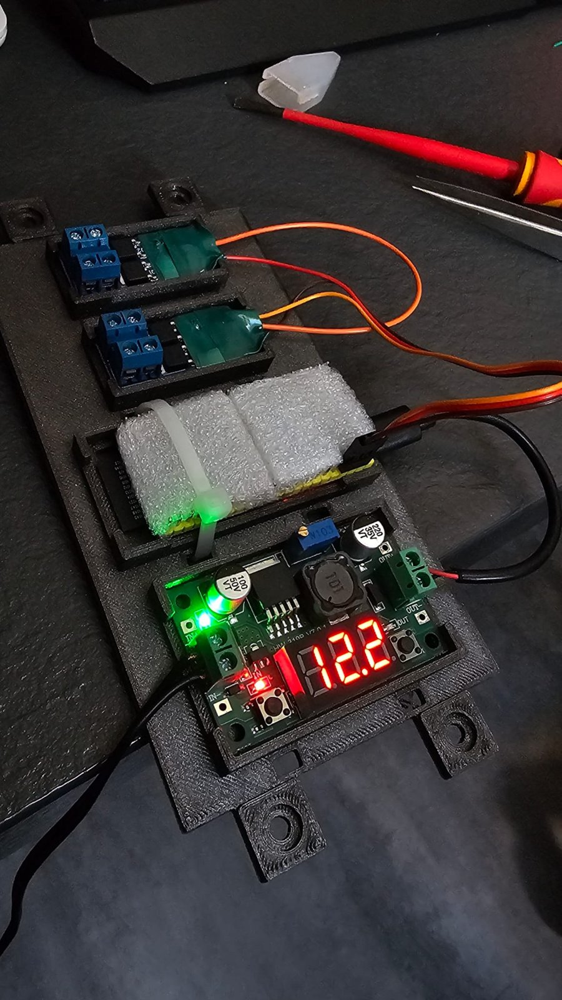
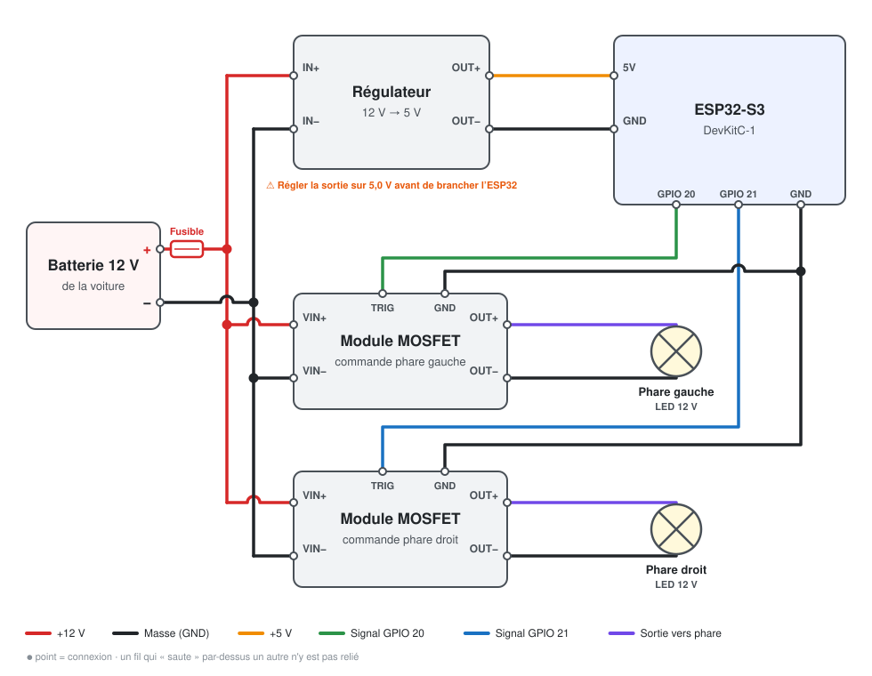

# Car Flash Light

**Fais flasher les phares de ta voiture depuis ton téléphone, en Bluetooth.**

Un petit boîtier à base d'ESP32-S3 se branche sur le 12 V de la voiture et pilote deux lumières (gauche et droite). Une application web, installable sur le téléphone comme une vraie appli, permet de choisir parmi 17 effets : stroboscope, alterné gauche/droite, doubles et triples flashs, fondu, gyrophare, respiration, rafales avec pause…

Le projet a été monté sur une Mazda MX-5, mais il fonctionne sur **n'importe quel véhicule en 12 V** : voiture, utilitaire, quad, moto, remorque, char de carnaval, scène… Il suffit de deux lumières LED 12 V et d'une alimentation 12 V.

<p align="center">
  
</p>

<p align="center"><em>Le boîtier : les deux modules de commande (en haut), l'ESP32-S3 (au milieu) et le régulateur 12 V → 5 V avec son afficheur (en bas), sur un support imprimé en 3D.</em></p>

---

## Sommaire

- [Fonctionnalités](#fonctionnalités)
- [Matériel](#matériel)
- [Schéma de câblage](#schéma-de-câblage)
- [Installation](#installation)
- [Utilisation](#utilisation)
- [Personnalisation](#personnalisation)
- [Dépannage](#dépannage)
- [À savoir avant de rouler](#à-savoir-avant-de-rouler)

---

## Fonctionnalités

- **Contrôle sans fil** en Bluetooth Low Energy, depuis une application web.
- **Connexion protégée par un code** à 6 chiffres : seul un téléphone appairé avec le bon code peut piloter les phares.
- **Application installable** sur l'écran d'accueil (Android), qui s'ouvre en plein écran et fonctionne sans Internet une fois installée.
- **Reconnexion automatique** : si la liaison est coupée (contact coupé, téléphone trop loin), l'appli se reconnecte toute seule dès que la carte est de nouveau disponible.
- **Mémorisation sur la carte** : au démarrage, la carte reprend directement le dernier mode et les derniers réglages, sans avoir besoin du téléphone.
- **17 modes de flash** (voir le détail ci-dessous).
- **Favoris** : enregistre une combinaison mode + vitesse + luminosité + pause et rappelle-la en un appui.
- **Réglages en direct** : vitesse, luminosité, durée des pauses.
- **Aperçu à l'écran** des deux feux, synchronisé avec l'effet choisi.
- **Bouton marche/arrêt** qui relance le dernier mode utilisé.
- **Témoin sur la carte** : la LED RGB de l'ESP32 s'allume en rouge pour la gauche et en bleu pour la droite, pratique pour tester sans rien brancher.

### Les modes

Les noms sont ceux affichés dans l'application. G = phare gauche, D = phare droit.

| Mode | Phares | Séquence |
|---|---|---|
| **Fixe** | G + D | allumés en continu |
| **Strobo** | G + D | flashs réguliers, les deux ensemble |
| **Alterné** | G puis D | G → D → G → D… |
| **Double** | G puis D | 2 flashs G → 2 flashs D |
| **Triple** | G puis D | 3 flashs G → 3 flashs D |
| **Fondu** | G puis D | G s'allume pendant que D s'éteint, en douceur |
| **Gauche** | G seul | strobo sur le phare gauche uniquement |
| **Droite** | D seul | strobo sur le phare droit uniquement |
| **Strobo ×3** | G + D | 3 flashs → pause |
| **Double + pause** | G puis D | 2 flashs G → pause → 2 flashs D → pause |
| **Triple + pause** | G puis D | 3 flashs G → pause → 3 flashs D → pause |
| **3 + 2** | G + D | 3 flashs → pause → 2 flashs → pause |
| **2 + 2** | G + D | 2 flashs → pause → 2 flashs → pause |
| **3 + 1** | G + D | 3 flashs → pause → 1 flash → pause |
| **Respiration** | G + D | les deux s'allument et s'éteignent doucement, ensemble |
| **Gyrophare** | G puis D | 4 flashs rapides G → 4 flashs rapides D |
| **Accélération** | G + D | strobo de plus en plus rapide pendant 4 s → pause |

La **vitesse** règle la rapidité des flashs (pour Accélération, c'est la vitesse atteinte à la fin). La **pause** règle la durée des temps morts : elle s'applique aux modes de Strobo ×3 à 3 + 1, et à Accélération.

---

## Matériel

| Qté | Composant | Rôle | Lien |
|:---:|---|---|---|
| 1 | Carte **ESP32-S3 DevKitC-1** | Le cerveau : Bluetooth et génération des effets | [Amazon](https://www.amazon.fr/dp/B0FZGJYPHK) |
| 1 | **Régulateur de tension** 12 V → 5 V avec afficheur | Alimente l'ESP32 à partir du 12 V | [Amazon](https://www.amazon.fr/dp/B0H2VRCJLN) |
| 2 | **Module de commande MOSFET** (déclencheur) | Allume et éteint chaque lumière 12 V | [Amazon](https://www.amazon.fr/dp/B0DG8B58PM) |
| 2 | Lumières **LED 12 V** | Phare gauche et phare droit | selon ton véhicule |
| 1 | **Fusible** et porte-fusible | Protège le circuit, calibre selon la consommation des LED | — |
| — | Fils, câbles Dupont, gaine thermo | Câblage | — |
| — | Support imprimé en 3D *(optionnel)* | Fixer et protéger les modules | — |

---

## Schéma de câblage

<p align="center">
  
</p>

### Les connexions une par une

**1. Alimentation 12 V**

Le + et le − du 12 V arrivent sur le régulateur et sur les deux modules :

| Depuis | Vers |
|---|---|
| + 12 V (après le fusible) | `IN+` du régulateur |
| + 12 V | `VIN+` du module gauche, puis repiqué vers `VIN+` du module droit |
| − 12 V (masse) | `IN−` du régulateur |
| − 12 V | `VIN−` du module gauche, puis repiqué vers `VIN−` du module droit |

**2. Alimentation de l'ESP32 en 5 V**

| Depuis | Vers |
|---|---|
| `OUT+` du régulateur (5 V) | broche `5V` de l'ESP32 |
| `OUT−` du régulateur | broche `GND` de l'ESP32 |

> ⚠️ **Règle la sortie du régulateur sur 5,0 V avant de brancher l'ESP32.** Tourne la petite vis du potentiomètre bleu en regardant l'afficheur (le bouton permet de basculer entre la tension d'entrée et celle de sortie). Plus de 5,5 V peut détruire la carte.

**3. Commande des modules**

| Depuis l'ESP32 | Vers |
|---|---|
| `GPIO 20` | entrée `TRIG` / `PWM` du module **gauche** |
| `GPIO 21` | entrée `TRIG` / `PWM` du module **droit** |
| `GND` | `GND` (côté commande) des **deux** modules |

> La masse commune est indispensable : sans le fil `GND` entre l'ESP32 et les modules, les lumières ne s'allument pas.

**4. Lumières**

| Depuis | Vers |
|---|---|
| `OUT+` / `OUT−` du module gauche | phare gauche |
| `OUT+` / `OUT−` du module droit | phare droit |

---

## Installation

### 1. Programmer l'ESP32

1. Installe l'**[Arduino IDE](https://www.arduino.cc/en/software)**.
2. Dans le gestionnaire de cartes, installe **esp32 by Espressif Systems**.
3. Ouvre `firmware/flash_esp32/flash_esp32.ino`. Le fichier doit rester dans un dossier qui porte **exactement le même nom** que lui (`flash_esp32`).
   En haut du fichier, **remplace `CODE_PIN` (123456) par ton propre code à 6 chiffres** : c'est lui que le téléphone demandera à la première connexion.
4. Dans le menu **Outils**, applique ces réglages :

   | Réglage | Valeur |
   |---|---|
   | Type de carte | **ESP32S3 Dev Module** (pas la version *Octal*) |
   | Flash Mode | QIO 80MHz |
   | Flash Size | 16MB (128Mb) |
   | PSRAM | Disabled |
   | USB CDC On Boot | Disabled |
   | Port | le port COM de la carte |

5. Branche la carte avec le port USB marqué **UART** (ou **COM**) et clique sur **Téléverser**. Si l'IDE reste bloqué sur « Connecting… », maintiens le bouton **BOOT** de la carte enfoncé jusqu'au début de l'écriture.
6. Ouvre le moniteur série à **115200 bauds** : le message `BLE prêt` doit s'afficher.

### 2. Installer l'application sur le téléphone

L'application est hébergée gratuitement avec GitHub Pages :

**👉 https://skyoroma.github.io/car-flash-light/**

- **Android (Chrome)** : ouvre le lien, appuie sur **⋮**, puis **Installer l'application**. Une icône apparaît sur l'écran d'accueil.
- **iPhone** : Safari ne gère pas le Bluetooth web. Ouvre le lien dans l'application gratuite **Bluefy**.
- **PC (Chrome ou Edge)** : la page fonctionne aussi directement dans le navigateur.

Pour héberger ta propre copie, fais un *fork* de ce dépôt, puis active **Settings → Pages → Branch : main**.

---

## Utilisation

1. Mets le contact (ou alimente le boîtier en 12 V). La carte reprend tout de suite le dernier mode utilisé.
2. Ouvre l'application et appuie sur **Connecter**, puis choisis **Car-Flash-Light** dans la liste.
3. **La première fois**, le téléphone demande un **code d'appairage** : tape le code défini dans le programme (`123456` par défaut, change-le, voir [Personnalisation](#personnalisation)). Le téléphone s'en souvient ensuite.
4. Choisis un mode, règle la vitesse, la luminosité et la pause.
5. Utilise le **bouton central** pour tout éteindre ou relancer le dernier mode.

**Favoris** : règle un effet qui te plaît, appuie sur **+** dans la section Favoris et donne-lui un nom. Un appui sur le favori renvoie ensuite tous ses réglages à la carte. Pour en supprimer, appuie sur **Modifier**, puis sur la croix du favori.

**Reconnexion** : si la liaison est coupée, le bouton en haut affiche « Reconnexion… » et l'appli réessaie toute seule. Appuie dessus pour annuler. Dans Chrome, l'appli peut aussi se reconnecter dès son ouverture à la dernière carte utilisée (si le navigateur le permet ; sinon, appuie sur **Connecter**).

L'icône de réglages, en haut à droite, affiche l'état de la connexion et le journal des messages échangés avec la carte.

### Réinitialiser la carte

Maintiens le bouton **BOOT** de l'ESP32 enfoncé pendant que tu mets le boîtier sous tension, environ 3 secondes, jusqu'à ce que la LED de la carte clignote 5 fois en blanc. Les téléphones appairés et les réglages mémorisés sont effacés. Pratique si tu as changé le code ou perdu ton téléphone.

---

## Personnalisation

Les réglages se trouvent en haut de `flash_esp32.ino` :

```cpp
#define NOM_BLE        "Car-Flash-Light"  // nom visible en Bluetooth
#define CODE_PIN       123456             // code d'appairage à 6 chiffres : CHANGE-LE !
#define SECURITE       1                  // 1 = code demandé, 0 = connexion libre
#define PIN_GAUCHE     20                 // sortie vers le module gauche
#define PIN_DROITE     21                 // sortie vers le module droit
#define PIN_RGB        48                 // LED témoin de la carte (38 sur certaines versions)
```

> 🔒 **Change `CODE_PIN` avant de téléverser.** Avec le code par défaut, n'importe qui connaissant ce projet pourrait se connecter à ta carte.

Tu peux renommer la carte comme tu veux (par exemple `MX5-Flash-Light`) : l'application la retrouve quel que soit son nom.

### Protocole Bluetooth

Les commandes ne sont acceptées qu'après appairage avec le code (si `SECURITE` vaut 1). La carte utilise le service **Nordic UART** (`6E400001-B5A3-F393-E0A9-E50E24DCCA9E`). Elle peut donc aussi se piloter avec n'importe quel terminal BLE (nRF Connect, Serial Bluetooth Terminal…) en envoyant du texte :

| Commande | Effet |
|---|---|
| `M:n` | choisit le mode `n` (0 = arrêt, 1 à 17) |
| `V:n` | vitesse, de 1 à 100 |
| `L:n` | luminosité, de 0 à 100 |
| `P:n` | pause, de 0 à 100 (× 15 ms, soit 0 à 1,5 s) |
| `?` | renvoie l'état : `ETAT mode vitesse luminosité pause` |

---

## Dépannage

| Problème | Solution |
|---|---|
| Rien ne s'affiche dans le moniteur série après le téléversement | Vérifie que la carte choisie est bien **ESP32S3 Dev Module** et non la version *Octal*. |
| Erreur `sdkconfig.h: No such file or directory` | Même cause : mauvaise variante de carte sélectionnée. |
| Le code d'appairage est refusé, ou n'est plus demandé après un changement de code | Dans les réglages Bluetooth du téléphone, choisis **Oublier** sur la carte, puis [réinitialise la carte](#réinitialiser-la-carte) et reconnecte-toi. |
| L'application ne trouve pas la carte | Déconnecte toute autre appli (nRF Connect…) : la carte n'accepte qu'une connexion à la fois. Sur Android, active aussi la localisation. |
| La LED témoin ne s'allume pas | Remplace `48` par `38` dans `PIN_RGB`. Sur certaines cartes, il faut aussi relier la petite soudure « RGB » près de la LED. |
| Les phares ne s'allument pas | Vérifie le fil `GND` commun entre l'ESP32 et les modules. |
| Un phare clignote brièvement à la mise sous tension | Ça peut arriver avec le GPIO 20, qui sert aussi à l'USB natif de la carte au démarrage. Si ça te gêne, utilise d'autres broches (par exemple 4 et 5). |
| L'ancienne version de l'appli reste affichée | Ferme complètement l'appli et rouvre-la une ou deux fois. |

---

## À savoir avant de rouler

En France, comme dans la plupart des pays, **les feux à éclats et les stroboscopes sont réservés aux véhicules prioritaires et d'intervention** sur la voie publique. Ce montage est destiné à un usage **hors circulation** : terrain privé, salon auto, rassemblement, tournage, spectacle…

Le circuit tire son énergie de la batterie : ajoute un fusible adapté et coupe l'alimentation quand le véhicule reste longtemps à l'arrêt.

---

## Structure du dépôt

```
├── index.html               Application web (télécommande)
├── manifest.webmanifest     Infos d'installation de l'appli
├── sw.js                    Fonctionnement hors ligne
├── icon-*.png               Icônes de l'appli
├── firmware/
│   └── flash_esp32/
│       └── flash_esp32.ino  Programme de l'ESP32-S3
└── docs/
    ├── photo-montage.jpg
    └── schema-cablage.svg
```
